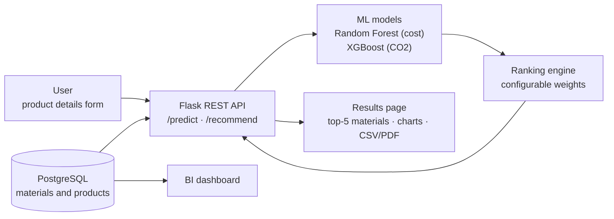

# EcoPackAI — Sustainable Packaging Recommendation Platform

EcoPackAI predicts cost efficiency & carbon footprint of packaging materials and recommends optimal eco-friendly options.

## Problem Statement

Traditional packaging used in industries and e-commerce heavily relies on non-biodegradable and costly materials, causing increasing environmental damage and financial inefficiency. EcoPackAI is an AI-powered platform that recommends optimal packaging materials based on product attributes, sustainability parameters, and industry standards, using machine learning to predict environmental impact (carbon footprint) and cost efficiency.

## Features

- AI-powered recommendation engine
- CO₂ and cost analytics dashboard
- Full-stack architecture: Flask, PostgreSQL, Bootstrap, ML models
- Deployment-ready cloud architecture

## Tech Stack

Python | Flask | PostgreSQL | HTML/CSS/Bootstrap | XGBoost | Random Forest | Plotly | GitHub Actions

## System Architecture



The user submits product details through the UI, which are sent to the Flask API. The API calls the ML models (Random Forest for cost, XGBoost for CO2) to get predictions, ranks the material options, and returns recommendations. Material and product data is stored in PostgreSQL, and the same data feeds the BI dashboard.

## Modules

| # | Module | Status |
|---|---|---|
| 1 | Data Collection & Management (schema, cleaning, ingestion scripts) | Done |
| 2 | Data Cleaning & Feature Engineering (EDA, imputation, encoding, CO2/cost/suitability indices) | Done |
| 3 | ML Dataset Preparation (targets, features, train/test split, ColumnTransformer pipeline) | Done |
| 4 | AI Models: baselines, experiment tracking, Random Forest (cost), XGBoost (CO2) | Done |
| 4b | Recommendation Engine: material ranking (`src/recommendation/ranker.py`) | Done |
| 4c | Explainability (SHAP, permutation) + final evaluation + model packaging (`src/inference/`) | Done |
| 5 | Flask Backend API: `/health`, `/ready`, `/predict`, `/recommend`, `/admin` (`backend/`, see `docs/api.md`) | Done |
| 5b | Backend integration: PostgreSQL/SQLAlchemy + migrations, caching, API-key auth, structured logging, tests | Done |
| 6 | Frontend UI: wireframes, 4 pages, product form with validation (`frontend/`, see `docs/ui_flow.md`) | Done |
| 6b | Analytics charts, CSV/PDF export, end-to-end UI tests in Chromium + Firefox (`docs/analytics.md`, `docs/e2e_test_report.md`) | Done |
| 6c | Frontend-backend integration: results under the form without reload, sortable table, response checks (`docs/ui_integration.md`) | Done |
| 7 | BI Dashboard (CO2 & Cost Analytics) | Planned |
| 8 | Deployment & Documentation | Planned |

## Repository Structure

```
EcoPackAI/
├── .github/workflows/ci.yml      CI: lint + data quality tests on every push
├── archive/                      v1 snapshots of data and data dictionary
├── backend/
│   ├── app.py                    Flask API entry point (/health, /ready)
│   ├── routes/                   predict.py, recommend.py, admin.py
│   ├── models/                   SQLAlchemy models (5 tables)
│   ├── db/                       connection, seeding, schema.sql (generated)
│   ├── migrations/               Alembic database migrations
│   ├── middleware/               API-key auth, request IDs, access log
│   ├── cache.py, logging_setup.py, services.py, settings.py
│   └── manage.py                 init-db, seed, export-schema, data-dictionary
├── data/
│   ├── raw_datasets/             original CSVs from the mentor
│   ├── processed/                cleaned CSVs (output of clean_data.py)
│   ├── model_ready/              encoded + engineered features
│   ├── model_input/              X / y and train/test splits
│   └── final/                    Parquet copies
├── docs/                         architecture diagram, data dictionary, reports
├── environments/                 requirements.txt, Dockerfile, docker-compose.yml
├── ml/
│   ├── notebooks/                EDA.ipynb, 01_dataset_prep.ipynb, 02_preprocessing.ipynb
│   ├── training/train_model.py   run_experiment(): train, evaluate, version, log
│   ├── models/                   versioned trained models ({model}_{target}_v{n}.pkl)
│   ├── experiments/metadata/     one JSON record per training run
│   └── metrics/                  baseline_metrics.csv
├── models/                       fitted preprocessing pipeline, encoders, scalers
├── config/                       ranking_weights.yaml, logging.yaml
├── outputs/material_rankings.csv top-5 materials per product (3 modes)
├── outputs/explainability/       SHAP and permutation importance plots
├── scripts/                      ingestion/, benchmark_cache.py, dev_postgres.py
├── src/inference/                predictor.py (single prediction interface), metadata.json
├── src/recommendation/ranker.py  material ranking engine
├── tests/                        pytest: data quality, ranking, predictor, API, database, reports, frontend;
│                                 frontend/*.test.js (Node); e2e/ (Playwright UI tests)
├── frontend/                     index, predict (form), results (charts, exports), dashboard + static/js, css, vendor
└── dashboard/                    Plotly analytics (planned)
```

## Setup

```bash
conda create -n ecopackai python=3.11 -y
conda activate ecopackai
pip install -r environments/requirements.txt
pip install -r environments/requirements-dev.txt     # test coverage + local PostgreSQL helper
copy .env.example .env                               # then set your own API keys in .env
```

See `docs/env_setup.md` for details. Database options (`docs/database.md`): SQLite by default (no
setup), a local PostgreSQL without Docker (`python scripts/dev_postgres.py`), or the full stack
(Flask + PostgreSQL + pgAdmin) with `docker compose -f environments/docker-compose.yml up`.

## Running the Project

All commands run from the project root.

```bash
python scripts/ingestion/clean_data.py     # raw CSVs -> data/processed/
python scripts/ingestion/ingest_data.py    # data/processed/ -> PostgreSQL
python src/recommendation/ranker.py        # rank materials -> outputs/material_rankings.csv
python src/inference/build_metadata.py     # regenerate metadata.json after retraining a model
python backend/manage.py init-db           # create the database tables and load the CSVs (once)
python backend/app.py                      # start the API + website: open http://127.0.0.1:5000/
python -m playwright install chromium firefox   # once, for the end-to-end UI tests
pytest tests -v                            # all tests incl. end-to-end (SQLite); set TEST_DATABASE_URL for PostgreSQL
node --test tests/frontend/predict.test.js tests/frontend/charts.test.js tests/frontend/recommendation_table.test.js
python scripts/benchmark_cache.py          # cache performance before/after (docs/caching.md)
```

Notebooks in `ml/notebooks/` run in order: `EDA` -> `02_preprocessing` -> `01_dataset_prep` -> `03_rf_cost_model` -> `04_xgb_co2_model` -> `05_model_explainability` -> `06_final_evaluation`.

## Evaluation Metrics

Model performance is assessed using RMSE, MAE, and R² Score for both the cost prediction and CO₂ footprint prediction models.

## License

This project is for educational and personal portfolio use.
