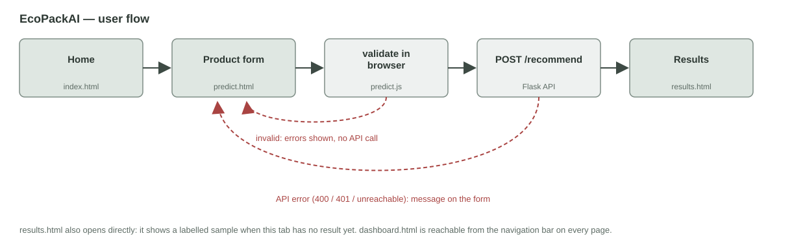

# Frontend UI — Pages, Layout and User Flow

| Part | Location |
|---|---|
| HTML pages | `frontend/index.html`, `predict.html`, `results.html`, `dashboard.html` |
| Styles | Bootstrap 5.3.3 (shipped in `frontend/static/vendor/`) + `frontend/static/css/style.css` |
| Scripts | `frontend/static/js/layout.js`, `predict.js`, `results.js`, `charts.js`, `sample_result.js`; Chart.js 4.4.4 in `static/vendor/` |
| Wireframes | `docs/wireframes/*.svg` (generated by `python scripts/make_wireframes.py`) |
| Screenshots | `docs/screenshots/<page>-desktop.png`, `<page>-tablet.png` |
| Input rules | `docs/frontend_validation.md` |
| Tests | `tests/frontend/*.test.js` (Node), `tests/test_frontend.py` (pytest), `tests/e2e/` (Playwright, Chromium + Firefox) |
| Charts and exports | `docs/analytics.md` |

## 1. Opening the Pages

| How | What works |
|---|---|
| Double-click `frontend/index.html` (no backend) | All pages, navigation, layout, form validation, the results page with sample data. Submitting shows "Cannot reach the API" |
| `python backend/app.py`, then open **http://127.0.0.1:5000/** | Everything, including real recommendations |

The Flask app serves the same files (`/`, `/<page>.html`, `/static/...`), so the pages call
the API from the same address and no cross-origin (CORS) setup is needed. Only the four
known pages are served; any other path returns a JSON 404.

## 2. Screens

| Screen | File | Wireframe | Purpose |
|---|---|---|---|
| Home / Overview | `index.html` | `01_home.svg` | What EcoPackAI does, key numbers, the 4-step process, links to the form and an example |
| Product input | `predict.html` | `02_product_input.svg` | Product form with validation; optional ranking mode, result count and API settings; ranked results appear below the form (sortable table, no page reload) |
| Recommendation results | `results.html` | `03_results.svg` | Ranking-mode switch, CSV/PDF export, product summary, best choice, ranked table, 3 charts (CO₂, cost, score ranking) |
| Analytics dashboard | `dashboard.html` | `04_dashboard.svg` | Placeholder: 4 KPI cards and 4 chart areas, each naming its future data source |

Wireframes are low fidelity (grey boxes on the 12-column grid); the screenshots in
`docs/screenshots/` show the built pages at desktop (1280 px) and tablet (768 px) width.

## 3. User Flow



1. **Home** → "Get a recommendation" opens the product form.
2. **Product form** → on submit, `predict.js` validates every field in the browser.
   - Invalid: errors appear next to each field plus a summary at the top; the cursor moves
     to the first problem; **no request is sent**.
   - Valid: `POST /recommend` with the JSON payload (see `docs/frontend_validation.md`).
3. **API answer**
   - Success: the response is checked (`validateRecommendResponse`), stored for this browser tab and
     shown as a sortable table **under the form, without a page reload**; "View charts & export"
     opens `results.html`. An incomplete response is rejected with a message (`docs/ui_integration.md`).
   - 400 (server-side validation): server messages are shown on the matching fields.
   - 401 / 403: a message asks for a client key, and the API settings open.
   - No answer / timeout (15 s): a message explains how to start the API.
4. **Results page** → best choice, sortable ranked table, charts, exports; "Edit product" returns to the form with the
   previous values filled in; "New product" opens an empty form.
   - No material passes the constraints (e.g. fragile drinkware by sea): an explanation
     replaces the table.
   - Opened directly with no result in this tab: a labelled sample (real API output for a
     chocolate box) is shown.

## 4. Layout and Reusable Components

All pages share one structure:

```
<header id="site-header">    navigation bar   (layout.js)
<main>                        page content     (Bootstrap container + 12-column grid)
<footer id="site-footer">    footer           (layout.js)
```

| Component | Where | Notes |
|---|---|---|
| Navigation bar | `layout.js` → every page | Brand + 4 links; current page highlighted (`aria-current="page"`); collapses to a menu button below 768 px |
| Footer | `layout.js` → every page | Project line and model names |
| Fallback navigation | `<noscript>` in every page | Plain links if JavaScript is off |
| Card | Bootstrap `.card` + `style.css` | Steps, form, product summary, KPIs, chart placeholders |
| Form field | `predict.html` | Label, input, rule hint (`.form-text`), error slot (`.invalid-feedback`), linked with `aria-describedby` |
| Alerts | Bootstrap `.alert` | Error summary (danger), API status (info / warning / danger), sample notice (info), no-result (warning) |
| Score bar | `results.js` | Bootstrap progress bar with `aria-valuenow` |

**Grid per screen (desktop → tablet):**

| Screen | Desktop (≥ 992 px) | Tablet (768–991 px) |
|---|---|---|
| Home | Hero 7 + stats 5 columns; 4 step cards in a row; 2 action cards | Hero and stats stacked; step cards 2 × 2; action cards side by side |
| Product input | Form 8 + sidebar 4; fields in 2 columns | Form full width, sidebar below; fields still in 2 columns |
| Results | Product summary 4 + results 8 | Summary above, results full width; table scrolls inside its card if needed |
| Dashboard | KPIs 4 in a row; charts 2 × 2 | KPIs 2 × 2; charts stacked |

Checked in a real browser at 768 px: no page scrolls sideways.

## 5. Alignment With the Backend

| Frontend | Backend |
|---|---|
| Form submits to `POST /recommend` | `backend/routes/recommend.py` |
| Category list (6) | `category_suitability` in `config/ranking_weights.yaml` |
| Shipping types, fragility 1–5 | `SHIPPING_TYPES`, `FRAGILITY_RANGE` in `backend/routes/predict.py` |
| Ranking modes, default mode, default top N | `modes`, `default_mode`, `top_n` in the ranking config |
| Top N max 20 | `MAX_TOP_N` in `backend/settings.py` |
| Product name max 100 characters | `products.product_name VARCHAR(100)` |
| Results table fields | `/recommend` response (`docs/api.md`) |
| Dashboard placeholders | `materials`, `recommendation_logs`, `recommendation_runs` tables; `/admin/stats` cache numbers |

`tests/test_frontend.py` fails if any of these drift apart. The product form uses
`/recommend` rather than `/predict` because `/predict` needs 18 material attributes, while a
user describing a product only knows the product.

## 6. Security and Accessibility Notes

- All data is written with `textContent`, never as HTML, so API values cannot inject markup
  (a test checks the scripts for `innerHTML`, `insertAdjacentHTML` and `document.write`).
- Bootstrap and Chart.js ship with the project (`static/vendor/`), so no page loads code from the internet;
  a test checks the files are byte-identical to the official releases (published SHA-384 hashes).
- The API key typed in "API settings" is kept in `sessionStorage` (this tab only) and sent
  as `X-API-Key`. Only client keys belong there, never admin keys.
- Every input has a `<label>`; errors are linked with `aria-describedby`, flagged with
  `aria-invalid`, and announced through `aria-live` regions.
